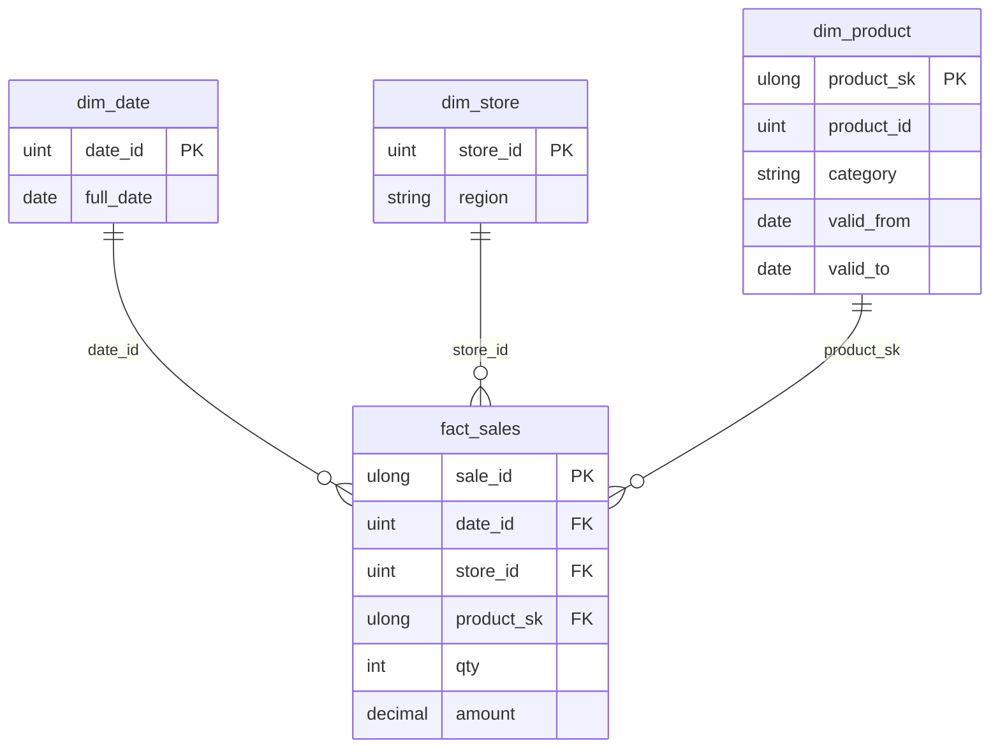

# Паспорт витрины оборота розничной сети

Шадура Глеб Александрович, СПД-ПИ-231 · 16 ноября 2026 г. · D1 «Розница»

## Цель и зерно

Витрина помогает руководителю сети сравнить оборот магазинов за I квартал 2024 г. и увидеть, какие товарные категории дали наибольший вклад в каждом регионе. В модели «звезда» по подходу Кимбалла зерно, измерения и меры определены для одного бизнес-процесса розничных продаж.

**Одна строка `fact_sales` — одна товарная позиция продажи с уникальным `sale_id`.** В позиции зафиксированы день, магазин, версия товара, количество единиц и сумма за всю позицию. В источнике отсутствует идентификатор чека, поэтому число строк отражает число позиций. Сопоставить позиции с чеками по этим полям нельзя.

| Мера | Аддитивность | Определение |
|---|---|---|
| `amount` | Да | Сумма всей позиции в денежных единицах источника, `DECIMAL(12,2)`. |
| `qty` | Да | Количество единиц товара в позиции. Для товарных категорий единицы учитываются поштучно согласно выгрузке. |
| Средняя сумма за единицу | Нет | `SUM(amount) / NULLIF(SUM(qty), 0)`. Взвешена по количеству, считается на выбранном срезе. |

## Измерения

| Измерение | Ключ | Атрибуты | История |
|---|---|---|---|
| `dim_store` | `store_id` | Название, город, регион | SCD1 при обновлении полного снимка. |
| `dim_date` | `date_id` в виде `YYYYMMDD` | Полная дата, год, месяц, название месяца, день недели | Календарные атрибуты статичны. |
| `dim_product` | `product_sk` для версии, `product_id` для товара | Название, бренд, категория, `valid_from`, `valid_to`, `is_current` | Категория SCD2. Название и бренд SCD1. |



На схеме PK означает логический уникальный ключ. В DuckDB его проверяет ограничение, а в ClickHouse уникальность обеспечивается проверками ELT. `product_sk` формируется из бизнес-ключа и даты начала версии. Для начальных версий начало действия принято равным первой дате календаря источника. При смене категории новая версия начинается в `effective_date`, старая действует до этой даты исключительно. Факт получает версию по дате продажи при загрузке и дальше присоединяет измерение по `product_sk`.

## Бизнес-вопросы

1. Как менялся оборот магазинов помесячно в I квартале 2024 года?
2. Какие категории дали наибольший оборот в каждом регионе квартала с учётом категории на дату продажи?
3. Какие три магазина лидировали по обороту квартала?

## Эталонная метрика

Оборот сети за I квартал — сумма поля `amount` по позициям продаж с 1 января по 31 марта 2024 г. включительно, по всем магазинам. В учебной выгрузке есть только продажи с неотрицательными суммами. Валюта не указана. Пустой срез даёт `0.00`.

```sql
SELECT COALESCE(SUM(f.amount), CAST(0 AS DECIMAL(38, 2))) AS turnover
FROM retail_mart.fact_sales AS f
JOIN retail_mart.dim_date AS d ON d.date_id = f.date_id
WHERE d.full_date >= CAST('2024-01-01' AS DATE)
  AND d.full_date < CAST('2024-04-01' AS DATE);
```

Эталон хранится в [`sql/canonical_metric.sql`](sql/canonical_metric.sql). Для графика динамики есть `agg_daily_store`. Зерно сводки — одна наблюдаемая дата × магазин. Поле `turnover` — сумма `amount` по этому дню и магазину.

## Ограничения

Данные курса содержат 15 позиций на восьми датах. Календарь отражает наблюдаемые даты. Отсутствие строки за день само по себе ничего не говорит о том, работал ли магазин. Учебный сценарий SCD2 отмечен в [описании источников](data/raw/README.md). Остальные ограничения описаны в [cut.md](cut.md).
